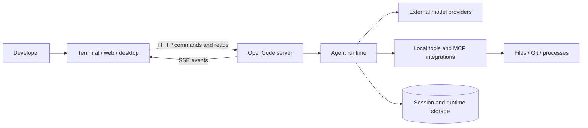
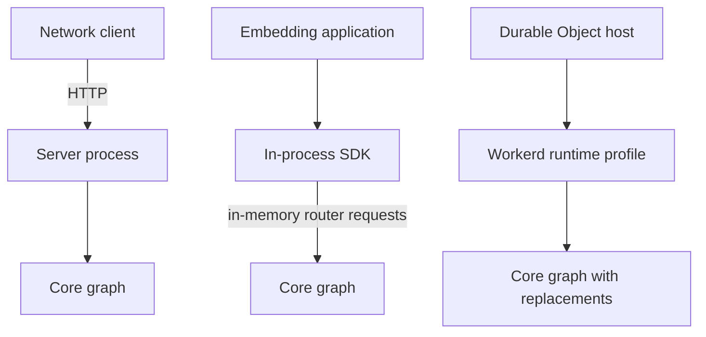

# 01 — System overview

[Architecture index](../README.md) · Next: [Package boundaries](02-package-boundaries.md)

## Purpose

The application lets users run AI agents against development workspaces. Agents receive instructions and queued input, call models, execute approved tools, and maintain durable Session state. Terminal, browser, desktop, and programmatic callers share that runtime rather than implementing separate agent engines.

The repository combines three different concerns:

1. **Agent product:** clients, API server, domain runtime, tools, and persistence.
2. **Embedding libraries:** a network Client and an in-process SDK.
3. **Supporting services:** website/docs, artifact distribution, release selection, Console, and analytics infrastructure.

Supporting hosted services are not the same process as a user's local agent server.

## System context

Arrows below describe interactions, not package imports.

### Ownership at a glance

| Area | Owns | Does not own |
| --- | --- | --- |
| User interfaces | Input editing, navigation, presentation, local view state | Authoritative Session execution |
| Server | HTTP routing, auth integration, transport, service composition | Canonical domain schema definitions |
| Core | Admission, execution, permissions, plugins, projections | UI rendering |
| AI package | A normalized model-call interface and provider protocols | Session scheduling or tool orchestration |
| Schema / Protocol | Domain shapes / HTTP operations | Local filesystem services |

## Three ways to host the runtime

- **Managed or explicit server:** the CLI can discover a shared background service or connect to an explicitly chosen server. A standalone path owns a private server.
- **Embedded SDK:** composes the Client, Server router, and Core inside one process; it opens no HTTP listener.
- **Workerd profile:** uses injected Durable Object SQLite and replaces local capabilities. It is not a full local filesystem/process environment.

These are alternative compositions, not three layers that every request passes through.

## Architectural constraints worth remembering

- Prompt acceptance is durable before execution is requested.
- Execution ownership is process-local. Recovery markers are not distributed locks.
- A model call is not an in-memory agent loop; continuation reloads projected history.
- Session state, optional retained event history, and client-local UI persistence are distinct stores/concerns.
- Browser-safe contracts stay independent of runtime implementations.

## Source anchors

- [Workspace and commands](../../package.json)
- [Server composition](../../packages/server/src/routes.ts)
- [Embedded host](../../packages/sdk/src/internal/host.ts)
- [Workerd profile](../../packages/server/src/workerd.ts)
- [Session contract](../../specs/v2/session.md)
- [Supporting services](../../services/README.md)
