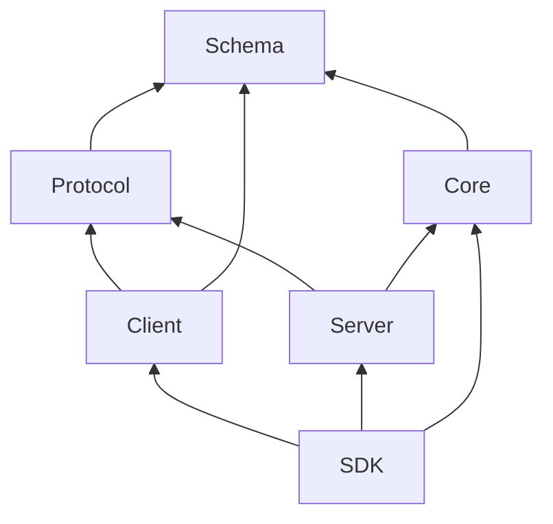

# 02 — Package boundaries

[Architecture index](../README.md) · Previous: [Overview](01-system-overview.md) · Next: [Runtime composition](03-runtime-composition.md)

## Runtime dependency backbone

Here **A → B means A depends on B**. This is the contract/runtime backbone, not every import in the monorepo.

Core and Protocol are sibling consumers of Schema. Server joins them. The Client runtime must not import Core or Server; SDK composition is the deliberate place where these worlds meet.

## Main packages

| Package | Responsibility | Start reading |
| --- | --- | --- |
| `schema` | Browser-safe wire/storage definitions, IDs, canonical event payloads | [Source directory](../../packages/schema/src) |
| `protocol` | HTTP operation groups, transport errors, middleware placement | [`src/api.ts`](../../packages/protocol/src/api.ts) |
| `core` | Sessions, execution, persistence, permissions, plugins, workspace capabilities | [`src/session.ts`](../../packages/core/src/session.ts), [`src/instance.ts`](../../packages/core/src/instance.ts) |
| `server` | Concrete handlers, middleware implementations, runtime assembly | [`src/routes.ts`](../../packages/server/src/routes.ts) |
| `client` | Generated Promise/Effect clients plus connection/service helpers | [`package.json`](../../packages/client/package.json), [`src`](../../packages/client/src) |
| `sdk` | Owns an embedded host and exposes familiar client APIs | [README](../../packages/sdk/README.md) |
| `ai` | Canonical LLM models, single-call execution, provider routes/protocols | [`src/llm.ts`](../../packages/ai/src/llm.ts) |
| `plugin` | Public Promise and Effect plugin/tool APIs | [`src/README.md`](../../packages/plugin/src/README.md) |
| `codemode` | Tool-oriented language interpreter independent of Session | [README](../../packages/codemode/README.md) |
| `util` | Shared infrastructure, Effect graph construction, platform utilities | [`src`](../../packages/util/src) |

## Product surfaces and presentation

| Package | Role |
| --- | --- |
| `cli` | Executable entrypoint, commands, service lifecycle, TUI launch, ACP integration. |
| `tui` | Solid/OpenTUI terminal application and feature plugins. |
| `app` | Shared SolidJS web application and server-scoped client state. |
| `desktop` | Electron main/preload/renderer shell and desktop-local persistence. |
| `session-ui` | Shared session/timeline presentation used by GUI surfaces. |
| `ui`, `theme` | Reusable components and appearance contracts. |
| `gui-extensions`, `plugin-browser` | GUI extension integration and browser-side plugin surfaces. |
| `storybook`, `simulation` | Component exploration and controlled runtime scenarios. |

This is not a claim that every UI package is import-isolated from Core. For example, `tui/package.json` declares Core as a dependency. The strict no-Core/no-Server boundary applies to **Client runtime code**, not every executable or UI package.

## Supporting areas

- `packages/httpapi-codegen`: compiles contracts into generated client code.
- `packages/effect-drizzle-sqlite`: shared database integration infrastructure.
- `packages/console`, `stats`, `enterprise`, `identity`, `function`: hosted product/support concerns; not the local Session engine.
- `services/*`: independently deployed website, update, file, and changelog services.
- `infra/`, `.github/workflows/`, `script/`, `nix/`: provisioning, verification, packaging, and automation.
- `sdks/vscode/`, `github/`: external integration surfaces.
- `packages/web/`: retained website/documentation tree; do not treat it as the current V2 documentation authority. Current V2 docs are under `services/www/src/docs/content`.

## Rules when changing boundaries

1. Put shared serializable contracts in Schema, not service implementations.
2. Put API methods and errors in Protocol, then bind behavior in Server.
3. Import canonical Schema values rather than copying schemas across packages.
4. After public Protocol or Server `HttpApi` changes, run `bun run generate` from `packages/client`; never hand-edit generated outputs.
5. Keep compatibility-only V1 contracts under their explicit compatibility entrypoints. Current APIs use `/api/...` and unversioned domain names.

Source authority: [root guardrails](../../AGENTS.md), [Schema guide](../../packages/schema/AGENTS.md), [Client dependencies](../../packages/client/package.json), and [contributor package map](../../CONTRIBUTING.md).
