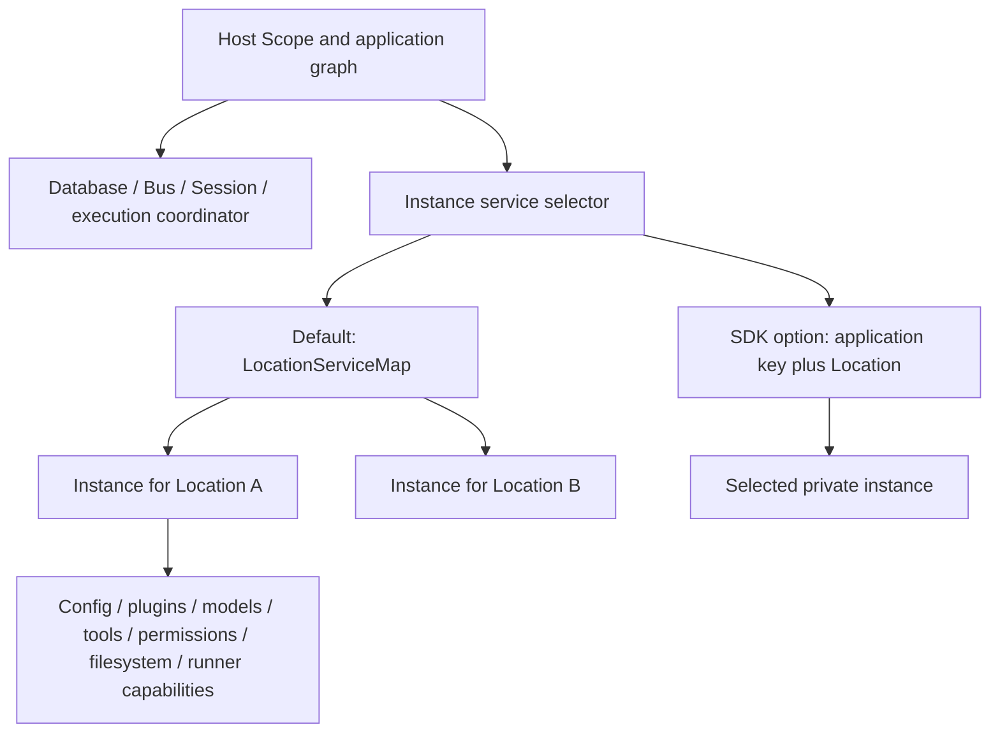

# 03 — Runtime composition and scopes

[Architecture index](../README.md) · Previous: [Packages](02-package-boundaries.md) · Next: [Sessions](04-session-execution.md)

## Why composition matters

Effect services express capabilities and resource lifetimes. `LayerNode`/application nodes describe how those services are assembled. Server compiles the host graph; a Location instance compiles the workspace-dependent graph. Runtime-profile replacements swap implementations without creating a different public API.

The application is not one global object containing every project's mutable state.

## Host services versus instance services

Arrows mean service selection or capability provision.

| Lifetime | Examples | Important consequence |
| --- | --- | --- |
| Host/global graph | Database, Bus, Session facade, inbox commands, execution coordination | Shared coordination across Sessions; not a Layer per Session ID. |
| Location/selected instance | Config, plugin supervisor, model resolver, tools, permissions, filesystem, runner capabilities | Capabilities reflect the selected placement and instance. |
| Plugin activation | Hook and tool registrations, setup-owned resources | Unloading removes that activation's contributions. |
| Request or model request | HTTP subscription queue; captured tool snapshot | Cleanup is local; registration changes apply to later model requests. |

“Global” here means the constructed application's global service graph. An embedded host owns its own graph; it is not an authorization boundary or a universal singleton across unrelated hosts.

## Default Location lookup

1. A Session operation loads saved Session placement when capabilities are needed.
2. The default `Instance.Service` borrows a graph from `LocationServiceMap`.
3. The map canonicalizes the Location reference and builds a fresh `Instance.layer` on a cache miss.
4. The instance binds its Location and plugin birth configuration while sharing designated host services.
5. Healthy graphs remain cached. Failed builds are evicted so construction can retry.

Omitted `workspaceID` is implicit-local placement. Explicit workspace identity is reserved for additional placement semantics; its presence does not imply that clustered execution already exists.

## Execution does not pin Session placement

`SessionExecution` owns a process-local, Session-ID-keyed coordinator. It reloads the Session and selects instance services at drain start. Movement or reload can cause a handoff to a newly selected graph. An ID-bound Session value keeps its ID, not a permanently selected runner or cached projection.

Invalidating a Location detaches routing and initiates shutdown. A running step may still hold a borrowed graph until its safe handoff boundary. This is lifecycle management, not distributed fencing.

## SDK-selected instances

The optional SDK `instances` selector adds an application key derived from Session metadata. The same key **and** Location share an instance; different keys or placements select separate capability graphs.

- Selection is synchronous; initialization belongs in `configure`/plugin setup.
- Loaded instances normally live until host close.
- Metadata reads need not initialize capabilities.
- This separates plugin configuration, **not** Session storage or authorization.

## Source anchors

- [Host assembly and replacements](../../packages/server/src/routes.ts)
- [Application graph builder](../../packages/core/src/effect/app-node-builder.ts)
- [Instance graph](../../packages/core/src/instance.ts)
- [Instance selector](../../packages/core/src/instance/service.ts)
- [Location map construction](../../packages/core/src/location-services.ts)
- [Location map contract](../../packages/core/src/location-service-map.ts)
- [Execution selection](../../packages/core/src/session/execution.ts)
- [SDK instance rules](../../packages/sdk/README.md)
