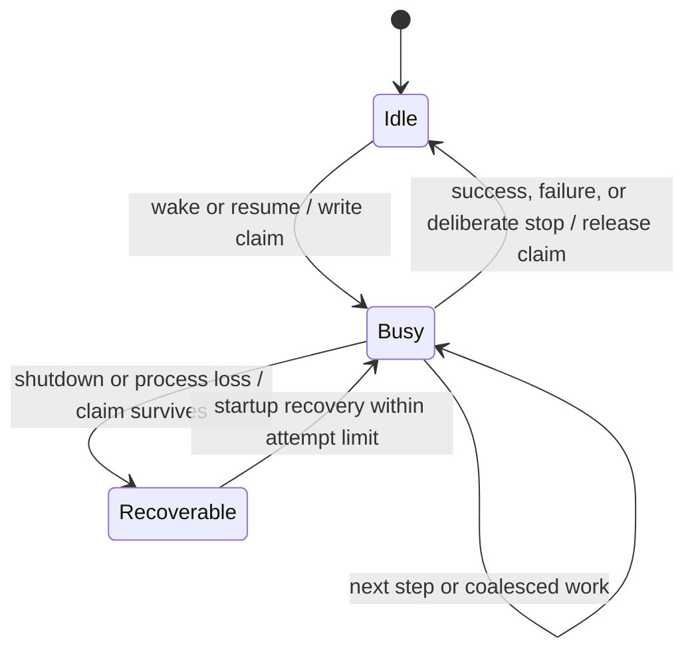

# 04 — Session admission, execution, and recovery

[Architecture index](../README.md) · Previous: [Runtime composition](03-runtime-composition.md) · Next: [Persistence](05-persistence.md)

## Separate acceptance from running

A successful prompt admission means input has been recorded, not that a model has finished or even started. `resume: false` admits without scheduling. Otherwise, admission is followed by an advisory wake.

```mermaid
sequenceDiagram
    participant Caller
    participant Session as Session operation
    participant Bus as Bus and projectors
    participant DB as SQLite
    participant Exec as SessionExecution
    participant Runner as Selected instance runner
    Caller->>Session: prompt(sessionID, input)
    Session->>Session: Reconcile identity; prepare only new input
    Session->>Bus: Publish session.inbox.enqueued
    Bus->>DB: Commit inbox projection and sequence
    DB-->>Session: Admission committed
    opt resume is not false
        Session->>Exec: wake(sessionID)
    end
    Session-->>Caller: Accepted input
    Exec->>Runner: Drain eligible work
    Runner->>Bus: Publish session.inbox.delivered
    Bus->>DB: Atomically consume inbox and insert visible input
```

The sequence shows state projection, not unconditional historical event retention. [Persistence](05-persistence.md) explains that separate option.

### Identity and delivery

- Reusing a Session ID adopts the existing Session.
- Reusing a user/synthetic inbox ID is idempotent when Session and type match: first admission wins, including payload, metadata, and delivery mode.
- Cross-Session or cross-type reuse fails. Control items have operation-specific conflict rules.
- `steer` is the default: deliver at safe step boundaries.
- `queue` waits while the Session can continue; at idle, steers take priority, otherwise one queued item is delivered before continuation is reevaluated.
- Compaction and move requests are inbox control items. They form delivery boundaries and do not become user transcript messages.
- At safe boundaries, steered compaction has priority up to the first steered move; other steers preserve enqueue order.

## Process-local coordination

The coordinator joins explicit resumes for the same Session, coalesces wakes, and permits different Sessions to run concurrently. Interrupting a known idle or locally unowned Session is a no-op; the public API rejects an unknown Session.



These are conceptual execution states, not exact stored enum names. The claim marks a recoverable busy period; it is not a distributed lease or proof that the process is alive.

## What happens inside a step

1. Reload projected Session history and selected agent/model.
2. Synchronize instructions and prepare model-visible context.
3. Capture the advertised tool set and its executable values.
4. Make an explicit `llm.stream` call and project model events.
5. Record complete tool calls before their side effects; local calls may run concurrently.
6. Settle local/hosted calls before the step's terminal event.
7. If continuation is required, reload history and begin the next logical step.

A logical step can have additional physical attempts for narrow retry/recovery cases. Generic retry has a bounded budget and observable scheduling. Partial-output continuation preserves the partial assistant message rather than silently replacing it. There is no provider-owned in-memory tool loop.

New user-input promotion resets the selected agent's step allowance; a batch of steers resets it once. Compaction changes active model context without deleting the durable transcript.

## Recovery guarantees and limits

- A write-ahead execution claim survives shutdown interruption or an unclean exit.
- Startup recovery targets claimed top-level Sessions with bounded per-execution attempt accounting.
- Orphaned running/streaming tool projections are failed before further model work.
- Recovery reloads projected history; it does not blindly rerun ambiguous tool effects.
- Neither provider requests nor external tool effects have an exactly-once guarantee.
- Pending inbox work and the execution claim are different: an advisory wake is not a recovery protocol.

## Source anchors

- [Current Session specification](../../specs/v2/session.md)
- [ID-addressed facade](../../packages/core/src/session.ts) and [ID-bound operations](../../packages/core/src/session/session.ts)
- [Inbox commands and delivery](../../packages/core/src/session/inbox.ts)
- [Execution](../../packages/core/src/session/execution.ts) and [coordinator](../../packages/core/src/session/run-coordinator.ts)
- [Runner](../../packages/core/src/session/runner/index.ts) and [physical attempt](../../packages/core/src/session/runner/step.ts)
- [Restart recovery](../../packages/core/src/session/execution/restart.ts)
