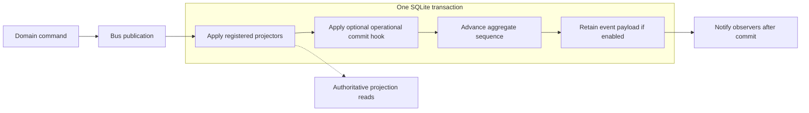
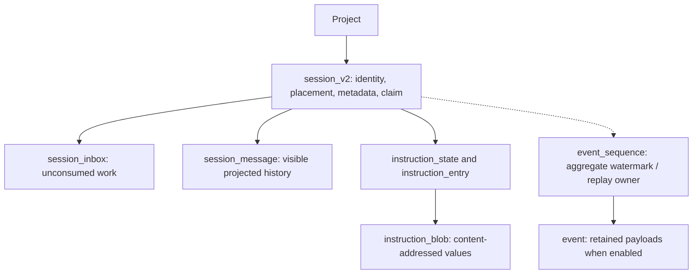

# 05 — Persistence and read models

[Architecture index](../README.md) · Previous: [Sessions](04-session-execution.md) · Next: [Event streams](06-event-streams.md)

## Storage model

Core uses SQLite with Drizzle and Effect-based SQL integration. Domain events drive transactional projections, while queries normally read those projections. This is an event-driven projection architecture with **optional historical event payload retention**, not an assumption that every host retains a complete event-sourcing log.

This diagram emphasizes the atomic boundary; individual publication/replay branches have their own internal ordering. A failed projection aborts the transaction. External model/tool side effects are outside this transaction.

## Principal stored concepts

Conceptual relationships below are intentionally smaller than a full physical ER diagram. Not every arrow is a SQL foreign key.

| Store | Why it exists |
| --- | --- |
| `session_v2` | Current Session placement, selection, aggregate counters, lifecycle/read information, and recovery marker. Its physical name retains the historical suffix. |
| `session_message` | Ordered, queryable visible messages, including projected assistant/tool state. |
| `session_inbox` | Only unconsumed user, synthetic, compaction, and move work. Delivery consumes it atomically. |
| `event_sequence` | Aggregate ordering/watermark and event replay ownership metadata. |
| `event` | Historical durable event payloads, only when persistence is enabled. |
| `instruction_entry` | API-managed instruction source entries. |
| `instruction_blob`, `instruction_state` | Deduplicated instruction values and the current/epoch-initial projection. |

Other domain tables cover projects, permissions, plugin data, credentials, and additional runtime concerns. The diagram is not an exhaustive database inventory.

## Durability has two independent settings

| Concern | Current behavior |
| --- | --- |
| Database backing | `Database.layer()` and the SDK default to `:memory:` unless configured otherwise. The CLI server chooses a persistent database path. |
| Historical event retention | `Bus.configured` defaults `persist` to `false`; Server passes `events.persist` through. Projections and aggregate sequencing still commit. |
| Workerd | Uses injected Durable Object SQLite and explicitly enables event payload persistence. |
| Recovery | Uses execution claims and projected state; do not equate recovery eligibility with a full historical log being retained. |

A file-backed database does **not** automatically mean `sessions.log` can replay every past event. Conversely, enabling event retention over an in-memory database does not survive process loss. The current CLI startup passes a file path but does not explicitly enable `events.persist`.

## Instructions and compaction

Instruction updates record changed source keys and content hashes. Canonical values live in `instruction_blob`; `instruction_state` holds current and epoch-initial values. Later updates can freeze chronological rendered text. The initial baseline and later deltas have different rendering roles.

Compaction starts a new instruction epoch and builds a rolling summary plus bounded recent context for future requests. It does not delete the complete transcript. Fork, revert, and move operations have explicit baseline rules in the Session specification.

## Database lifecycle and migration

- Node/Bun storage applies tuning pragmas where supported, including WAL and foreign-key configuration.
- Migrations run during database construction, serialized for the database being bootstrapped.
- Durable Object SQLite uses capability guards instead of unsupported pragmas.
- Desktop-local storage and hosted-service databases are separate from Core's Session database.
- Event replay ownership (`event_sequence.owner_id`) is separate from process-local execution ownership.

## Source anchors

- [Database construction](../../packages/core/src/database/database.ts), [migration runner](../../packages/core/src/database/migration.ts)
- [Bus transaction and retention behavior](../../packages/core/src/bus.ts)
- [Event tables](../../packages/core/src/event/sql.ts), [Session tables](../../packages/core/src/session/sql.ts)
- [Session projectors](../../packages/core/src/session/projector.ts)
- [CLI persistent path selection](../../packages/cli/src/server-process.ts)
- [Server options](../../packages/server/src/options.ts), [Workerd persistence](../../packages/server/src/workerd.ts)
- [Instruction and compaction semantics](../../specs/v2/session.md)
