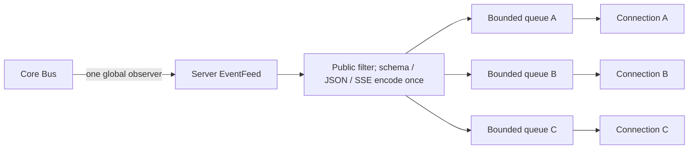

# 06 — Live events and durable replay

[Architecture index](../README.md) · Previous: [Persistence](05-persistence.md) · Next: [API and SDK](07-api-client-sdk.md)

## Two streams, different promises

| Property | Instance-wide live stream | Session durable log |
| --- | --- | --- |
| Main use | Responsive UI updates across Locations | Ordered Session event replay and follow |
| Entry | `/api/event` | `sessions.log({ sessionID, after?, follow? })` |
| Scope | Public live events across the server | One Session aggregate |
| Replay | None across a disconnect | Retained public durable events after an exclusive aggregate sequence |
| Streaming deltas | Can carry live text/reasoning/tool-input changes | Live-only deltas are excluded |
| Reconciliation | Refresh authoritative projections after a gap | Replay to a captured watermark, then follow |

Historical replay depends on [event retention](05-persistence.md). A durable event definition does not itself guarantee that every host retains its payload forever.

## Server-scoped SSE fan-out

Arrows mean notification delivery.



The feed is outside request Location middleware. Clients receive Location information and can maintain several Locations from one connection; Server must not silently filter this feed to a request directory.

### Delivery and failure boundaries

- Each connection has an independent queue of **4,096 public frames**.
- Encoding is shared; each queue stores references to the same immutable frame string.
- Offers do not wait for a slow client. Overflow removes and fails only that client's queue.
- Already accepted frames drain before the queue failure surfaces; the overflowing frame is not accepted by that connection.
- Connection-specific `server.connected` and heartbeats are generated outside the shared feed.
- A connection registers its queue before sending `server.connected`, then drains live frames.
- When there are no subscribers, the observer skips wire encoding.
- An encoding failure disconnects current subscribers rather than creating a silent gap; later valid connections/events remain possible.

The frame count is a finite lag budget, **not** a complete byte/memory bound. Socket, proxy, and client buffering sit outside it.

## Session replay-to-live handoff

```mermaid
sequenceDiagram
    participant Consumer
    participant Log as Session log / Core Bus
    participant Store as Retained event rows
    Consumer->>Log: log(sessionID, after, follow=true)
    Log->>Log: Subscribe before replay; capture watermark
    Log->>Store: Read ordered events after cursor through watermark
    Store-->>Consumer: Durable Session events
    Log-->>Consumer: Synchronization marker
    Log-->>Consumer: Later durable Session events
```

The synchronization marker separates replay from live following. It does not make the instance-wide volatile stream replayable. Request/response callers should use messages, pending input, and context projections; there is no separate finite Session-history endpoint.

## Client consequence

Clients combine connection status, initial reads, event application, and refresh/reconnect logic. Neither the UI nor an integration should interpret “SSE connected again” as proof that it saw everything while disconnected.

## Source anchors

- [Accepted event-stream design](../../specs/v2/event-stream-architecture.md)
- [Server feed](../../packages/server/src/event-feed.ts)
- [Event endpoint contract](../../packages/protocol/src/groups/event.ts)
- [Server event handlers](../../packages/server/src/handlers)
- [Core Bus log/subscription behavior](../../packages/core/src/bus.ts)
- [Session log contract](../../specs/v2/session.md)
- [Shared client connection helpers](../../packages/client/src/solid)
