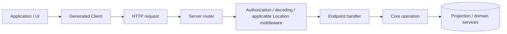
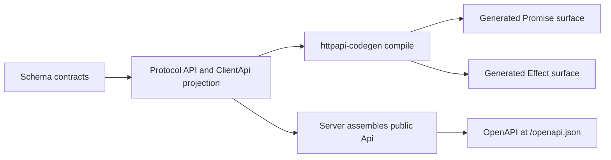
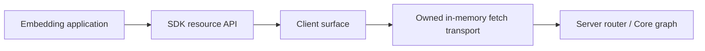

# 07 — API contracts, generated Client, and embedded SDK

[Architecture index](../README.md) · Previous: [Events](06-event-streams.md) · Next: [AI model layer](08-ai-model-layer.md)

## Contract ownership

- **Schema:** canonical domain values, IDs, event payloads, and runtime codecs.
- **Protocol:** endpoint methods/paths, request/response schemas, errors, streaming contracts, and middleware placement.
- **Server:** concrete middleware service identities, handlers, and runtime services.
- **Client:** generated caller-facing resource methods and transport adapters.
- **SDK:** owns a host and connects the Client to Server's router in memory.

## Network request path

Arrows mean request handling; event streams are documented separately.

This is a logical path, not the exact order of every middleware wrapper. Schema failures and domain errors are translated at their owning boundaries instead of leaking arbitrary Core implementation values into clients.

## Why several Location middleware types exist

| Middleware concern | How it selects capabilities |
| --- | --- |
| Location operations | Explicit request Location/directory. |
| Session operations | Saved placement for the addressed Session. |
| Form operations | The form's routing context; a temporary global MCP-elicitation sentinel remains documented in Server assembly. |
| Global operations/events | Do not blindly enter a request Location. |

Protocol declares which operations need these capabilities; Server injects their concrete implementations. Protocol therefore does not need to depend on Core service identities.

## Generation pipeline

Arrows mean build-time derivation, not runtime dependencies.

The current generator compiles `ClientApi` from Protocol and applies its curated group names/omissions. Server assembles the corresponding public `Api` with concrete middleware. They share contract ownership; there is no handwritten duplicate API specification to maintain.

- Promise entrypoints expose Promises and async-iterable streams.
- Effect entrypoints expose typed Effects, Streams, and canonical decoded schema values.
- Solid helpers manage reactive connection/PTy integration on top of the Client.
- Service helpers provide local background-service lifecycle/discovery support for host applications.

After public Protocol or Server `HttpApi` changes, run **`bun run generate` inside `packages/client`**. Do not edit generated files directly.

## Embedded SDK path

The SDK reuses routing and contract semantics without a TCP listener or network hop. It constructs a managed runtime, registers supplied plugins, installs optional Session-selected instances, starts recovery, and owns cleanup.

Closing the SDK releases router resources, scopes, Location capabilities, fibers, and plugin registrations. Its default database is in memory; configure a persistent path when restart continuity is required. Embedded routes intentionally do not add the network server's password authentication layer—access control belongs to the embedding application.

`ServerFetch.make` is a related lower-level entrypoint for hosts that supply `Request` objects. It builds eagerly in the caller's Scope and returns a standard fetch handler. Workerd applies explicit service replacements; it is not merely the Node server bundled unchanged.

## Source anchors

- [Protocol assembly](../../packages/protocol/src/api.ts), [client projection](../../packages/protocol/src/client.ts)
- [Concrete Server API](../../packages/server/src/api.ts), [routes](../../packages/server/src/routes.ts)
- [Location middleware](../../packages/server/src/location.ts), [Session middleware](../../packages/server/src/middleware/session-location.ts)
- [Client generator](../../packages/client/script/build.ts), [exports](../../packages/client/package.json)
- [SDK host](../../packages/sdk/src/internal/host.ts), [owned transport](../../packages/sdk/src/internal/fetch.ts), [SDK guide](../../packages/sdk/README.md)
- [Fetch host](../../packages/server/src/fetch.ts)
