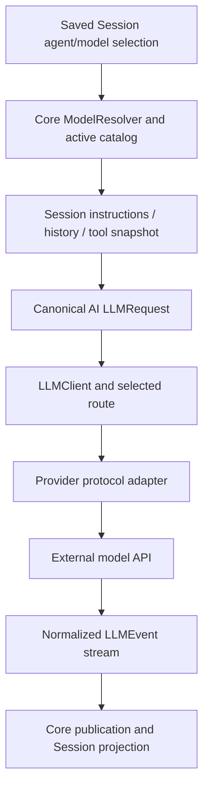

# 08 — AI model selection and provider protocols

[Architecture index](../README.md) · Previous: [API and SDK](07-api-client-sdk.md) · Next: [Tools](09-tools-and-code-mode.md)

## The key boundary

`packages/ai` performs model calls. Core decides **when**, **why**, and **with which Session context** a call happens. The AI package does not own Session orchestration, user approvals, or plugin lifecycle.

`LLM.stream`/`LLM.generate` each represent one model call. A Session drain can issue multiple calls by explicitly continuing from reloaded projected history.

## Request pipeline

Arrows mean request construction and provider adaptation.

## Responsibility split

| Layer | Responsibilities |
| --- | --- |
| Catalog/provider configuration in Core | Available models, provider endpoints/options, credentials, plugin transforms, and policy restrictions. |
| `ModelResolver` / runner model service | Resolve selection and variants into a concrete route model, capabilities, limits, costs, and transport settings. |
| Session request assembly | Instructions, model-visible history, compaction decisions, tools, and request hooks. |
| AI canonical schemas | Normalized request, message, content, tool definition, response, usage, and event shapes. |
| AI route/protocol | Provider-specific request/response transport and normalization. |
| Session runner | Durable publication, tool orchestration, bounded retries, terminal outcomes, and continuation. |

## Model availability is not just an ID lookup

A selected model must be available in the active catalog. Provider settings, credential availability, transforms, and policy affect usability. An explicitly selected unavailable model produces an error rather than silently pretending the selection is valid.

The runner resolves capabilities and context/output limits with the selected model. Compaction and request preparation use these values; provider-native continuation state cannot cross arbitrary history changes such as a completed compaction.

## Canonical models and protocol reuse

- Schema classes in `packages/ai/src/schema` are the AI package's canonical data model.
- Providers compose existing protocols/routes instead of cloning complete adapters.
- Provider pass-through values remain forward-compatible when OpenCode does not branch on them.
- AI schemas are related to, but not interchangeable with, public Session/domain schemas in `packages/schema`.
- Core's AISDK integration supports additional provider paths; it does not move Session ownership into the AI SDK.

## Failure boundaries

Provider transport/output is normalized before Core applies Session retry policy. Core distinguishes scheduled retry, provider-continuation rejection, incomplete streaming, context overflow, content filtering, and terminal failure. These cases do not all have the same retry or partial-message behavior.

For tool calls, a normalized event can identify a provider-hosted call or a locally executable call. Core owns local execution and stores canonical outcomes; a protocol can retain provider-specific result state when its replay format requires it.

## Source anchors

- [Single-call API](../../packages/ai/src/llm.ts)
- [Canonical AI schemas](../../packages/ai/src/schema/index.ts)
- [Route client](../../packages/ai/src/route/client.ts), [protocol implementations](../../packages/ai/src/protocols)
- [AI package constraints](../../packages/ai/AGENTS.md)
- [Core model resolver](../../packages/core/src/model-resolver.ts), [runner selection](../../packages/core/src/session/runner/model.ts)
- [Request assembly](../../packages/core/src/session/model-request.ts), [transport policy](../../packages/core/src/session/model-transport.ts)
- [Step execution](../../packages/core/src/session/runner/step.ts), [retry decisions](../../packages/core/src/session/runner/retry.ts)
- [AISDK integration](../../packages/core/src/aisdk.ts)
