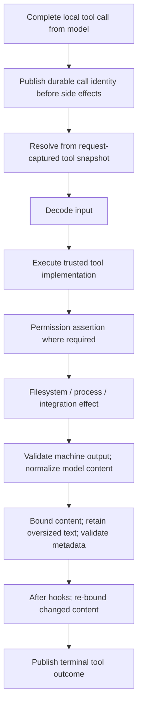
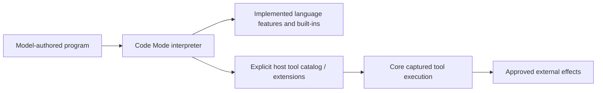

# 09 — Tools, permissions, and Code Mode

[Architecture index](../README.md) · Previous: [AI models](08-ai-model-layer.md) · Next: [Configuration and plugins](10-configuration-and-plugins.md)

## One executable tool contract

The public Plugin tool API describes input/output schemas and a single executor. Built-ins, application plugins, and dynamic MCP tools converge on the same Core execution seam; sharing a structural contract does not give them equal authority.

A tool's name comes from its registration, not from the reusable executable value. Registrations are scoped overlays: the latest active registration wins, and removing it reveals the previous active value.

## Invocation lifecycle

Arrows show one local tool invocation, not an extra model call.

This is the common trusted-tool path. Permission requests are formulated by implementations at the appropriate point; the registry does not automatically authorize arbitrary executors. Invalid input never executes the tool, and invalid output never becomes a successful result.

The runner supplies Session ID, agent, assistant message ID, and call ID. Call IDs are only unique within the step, so durable attribution also needs the assistant message ID.

## Three output channels

| Channel | Consumer and lifetime |
| --- | --- |
| `output` | Schema-validated machine value for Code Mode; ephemeral rather than a second durable model representation. |
| `content` | Canonical model-facing content retained in the Session outcome. |
| `metadata` | Optional compact JSON for tool-specific UI; separately validated and bounded. |

Large textual model content is replaced by a bounded preview and retained in managed storage. If complete retention fails, execution fails operationally rather than claiming lossless success. Native media and producer-side capture limits have their own ownership; registry bounding cannot restore bytes a producer already discarded.

Expected `ToolFailure`, interruption, and unexpected defects remain different outcomes. Cancellation must not be swallowed and turned into a normal tool result.

## Code Mode is interpretation, not arbitrary JavaScript execution

The standalone interpreter has no inherent filesystem, process, module-import, or network access. Host-supplied tools and extensions define what it can do. A host may explicitly add a capability such as fetch; that is not ambient authority provided by the language.

The host can impose time, call, output, and data limits. Unfinished work is interrupted when a program completes. Code Mode reduces multiple tool interactions into one interpreted program; it does not replace durable Session orchestration or bypass tool permissions.

## MCP's place

Core's MCP integration adapts external tools into the local tool model. MCP connection lifecycle, discovery, elicitation, and configuration remain separate from the generic tool registry. A remote tool's effects occur outside the local database transaction and are not exactly-once recoverable.

## Source anchors

- [Current tool semantics](../../specs/v2/tools.md)
- [Public tool API](../../packages/plugin/src/effect/tool.ts)
- [Core registry/execution](../../packages/core/src/tool.ts), [output retention](../../packages/core/src/tool-output.ts)
- [Permission service](../../packages/core/src/permission.ts)
- [MCP adapter](../../packages/core/src/tool/mcp.ts), [MCP subsystem](../../packages/core/src/mcp/index.ts)
- [Core Code Mode integration](../../packages/core/src/codemode)
- [Interpreter architecture and limits](../../packages/codemode/README.md)
- [Durable tool publication](../../packages/core/src/session/runner/step.ts)
