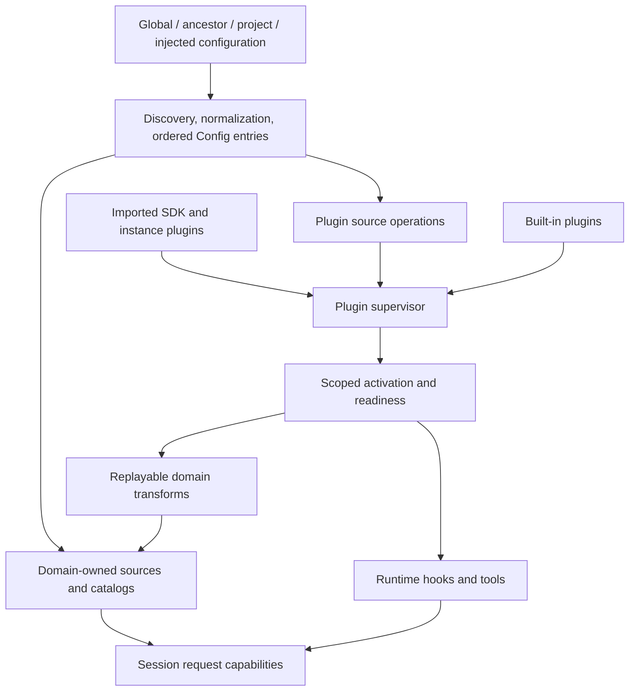

# 10 — Configuration, plugins, and extension lifecycles

[Architecture index](../README.md) · Previous: [Tools](09-tools-and-code-mode.md) · Next: [User interfaces](11-user-interfaces.md)

## Configuration is input to domain-owned state

Core's Location-scoped Config service discovers and normalizes ordered configuration entries. It also owns configuration root/watch topology. Domain owners consume the entries and relevant change notifications to rebuild their own state; Config is not one mutable registry containing all plugin/catalog behavior.

Arrows show configuration and capability contribution. Transforms rebuilding catalog state are different from runtime hooks intercepting an operation.

## Discovery and precedence

- Config entries are exposed from lowest to highest priority.
- Project discovery can include the Location directory's ancestors, not only the repository root.
- Direct `opencode.json(c)` discovery and `.opencode/opencode.json(c)` discovery have deliberate ordering; do not replace that with a guessed “nearest file only” rule.
- Global files, explicit files, inline content, well-known inputs, and discovered directories have different roles.
- Config normalization owns compatibility conversion and diagnostics before canonical decoding.
- Disabling implicit instance discovery does not cancel explicitly requested file-backed capabilities or use-triggered nested instruction discovery.

For exact precedence, read [discovery](../../packages/core/src/config/discovery.ts) and [Config construction](../../packages/core/src/config.ts); avoid maintaining a second exhaustive configuration reference here.

Terminal-only preferences have their own CLI configuration and must not be confused with server/project configuration. CLI/TUI themes, tabs, and keybindings are presentation concerns, not a second copy of the model catalog.

## Runtime plugin lifecycle

1. Resolve built-ins, configured module operations, and host/instance-supplied plugins.
2. Load modules and construct an ordered activation set.
3. Activate each generation in its owned scope; expose inventory and failures.
4. Register synchronous transforms and runtime hooks through narrow domain capabilities.
5. Rebuild affected domain state on reload; dispose superseded registrations/resources.

The supervisor keeps readiness pending while activation changes settle. Session entrypoints wait before consuming plugin-provided catalogs, commands, skills, or hooks. Otherwise, an early request could incorrectly see an empty registry.

Duplicate plugin IDs are reported rather than destroying the entire built-in generation. A failed module reload can retain a previously running generation. This does not mean every plugin setup failure is ignored; SDK-selected instance capability acquisition has stricter failure behavior documented in the SDK.

## Three extension surfaces, not one plugin host

| Surface | Owner | Extends |
| --- | --- | --- |
| Runtime plugins | `plugin` API + Core supervisor/host | Agents, models/providers, tools, Session hooks, integrations, references, skills, RPC, and other domains. |
| TUI plugins | `plugin/tui` API + TUI host | Terminal commands, views, and client-side interactions. |
| GUI extensions | `gui-extensions` SDK + App/Desktop hosts | Panels, settings, commands, contracts, and optional main-process IPC. |

Runtime Promise and Effect APIs offer corresponding capabilities. The Promise layer adapts async/await to the Effect implementation; callers should not recreate existing client domain operations in plugin interfaces.

GUI extensions use declared `provides`, `uses`, and `requires` contracts. Their window host belongs to App; their main-process host belongs to Desktop. They are not runtime plugins running inside the Session execution graph. Contributions and IPC resources must follow the current extension lifetime.

## Source anchors

- [Config service](../../packages/core/src/config.ts), [discovery](../../packages/core/src/config/discovery.ts), [plugin sources](../../packages/core/src/config/plugin/source.ts)
- [Plugin supervisor](../../packages/core/src/plugin/supervisor.ts), [readiness contract](../../packages/core/src/plugin/service.ts)
- [Runtime plugin host](../../packages/core/src/plugin/host.ts), [built-ins](../../packages/core/src/plugin/internal.ts)
- [Promise plugin API](../../packages/plugin/src/README.md), [Effect API](../../packages/plugin/src/effect/README.md)
- [GUI extension author guide](../../packages/gui-extensions/README.md), [host rules](../../packages/gui-extensions/AGENTS.md)
- [SDK instance/plugin lifecycle](../../packages/sdk/README.md)
