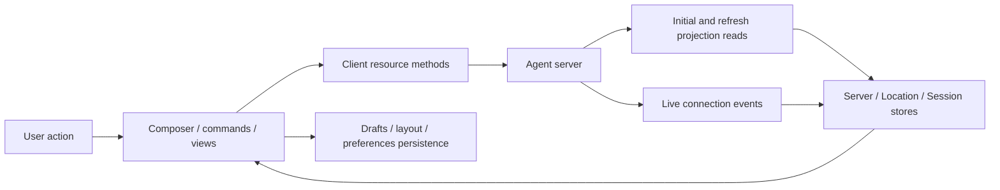
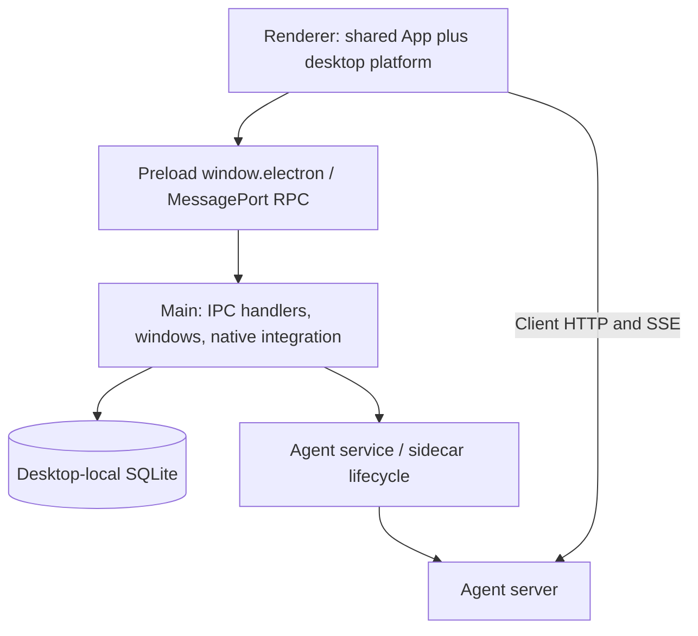

# 11 — CLI, terminal, web, and desktop interfaces

[Architecture index](../README.md) · Previous: [Plugins](10-configuration-and-plugins.md) · Next: [Security](12-security-boundaries.md)

## Shared principle: clients project server state

Clients submit operations through `@opencode/client`, load authoritative projections, and apply live notifications to reactive stores. Drafts, selected tabs, layout, and connection preferences remain client-local. Closing a client is not the same operation as interrupting a Session on a shared server.

Arrows mean UI data flow. A local optimistic state is not a substitute for durable server admission.

## CLI and TUI

| Area | Responsibility |
| --- | --- |
| CLI executable | Command dispatch, service discovery/startup, explicit or standalone server connections, launch options, noninteractive commands, ACP integration. |
| TUI root | Terminal application composition, routing, feature plugins, and interaction contexts. |
| Client context | API handle, live connection, managed reconnection, PTY helpers, event emitter. |
| Data context | Shared Client/Solid data layer, Location-scoped access, Session synchronization, and TUI-specific presentation state. |
| Local contexts | Tabs, storage, theme, prompt editing, terminal panels, and other client state. |

The TUI uses SolidJS with OpenTUI rendering. It is not the model execution host simply because CLI and TUI packages can access host-side dependencies.

For live-session development, `bun run dev:live [directory]` connects the development TUI explicitly to the elected service using the dev storage channel. It avoids unintentionally substituting a worktree server for the live server.

## Web application

`packages/app` is a SolidJS application. Its runtime separates server registry/selection, transport, request queues, connection status, per-server controllers, Location stores, and Session presentation.

- A selected server has its own API/PTY transport and live event source.
- Global and directory state load and refresh through dedicated synchronization modules.
- Shared session rendering lives in `session-ui`; base presentation comes from `ui`.
- GUI features contribute through the extension host instead of making the host know every feature's internals.
- Reconnection and authentication changes can replace a server controller; long-lived features must read current capabilities rather than keep stale handles.

## Electron desktop boundary

The renderer reuses the shared application, but native operations cross the preload/RPC boundary. They do not become direct filesystem calls from browser components. Main-process IPC handlers are composed separately from renderer code.

Desktop-local SQLite stores UI/native application state; the agent server's database stores Sessions. Shared persistence codecs validate loaded UI state and coordinate cross-window updates. Batched preference writes are a different consistency concern from transactional Session admission.

## Source anchors

- [CLI entrypoint](../../packages/cli/src/index.ts), [connection selection](../../packages/cli/src/services/server-connection.ts), [standalone](../../packages/cli/src/services/standalone.ts)
- [TUI root](../../packages/tui/src/app.tsx), [Client context](../../packages/tui/src/context/client.tsx), [data context](../../packages/tui/src/context/data.tsx)
- [App root](../../packages/app/src/app.tsx), [server transport](../../packages/app/src/runtime/server/client.tsx), [server runtime](../../packages/app/src/runtime/server/runtime.tsx)
- [Session presentation](../../packages/session-ui/src), [GUI host](../../packages/app/src/runtime/extension)
- [Desktop renderer composition](../../packages/desktop/src/renderer/desktop-app.tsx), [preload](../../packages/desktop/src/preload), [IPC composition](../../packages/desktop/src/main/ipc.ts)
- [Desktop storage](../../packages/desktop/src/main/storage), [shared persistence design](../../packages/app/src/runtime/persistence/README.md)
