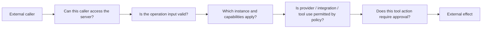

# 12 — Security and trust boundaries

[Architecture index](../README.md) · Previous: [Interfaces](11-user-interfaces.md) · Next: [Delivery](13-delivery-and-development.md)

## Different gates answer different questions

This is a conceptual separation of concerns, **not** a universal middleware order: provider policy affects catalogs, integration policy affects loading, and tool policy participates in permission evaluation. Not every read performs every gate.

| Boundary | Protects | Does not imply |
| --- | --- | --- |
| Server authentication | Access to the configured server surface | Per-Session tenant isolation. |
| Schema decoding | Shape and validity of boundary inputs | Authorization to execute an effect. |
| Location/instance selection | Correct capabilities for saved/requested placement | A security sandbox or ownership grant. |
| Permission service | Approval/policy decisions for trusted tool actions | Automatic safety for arbitrary plugin code. |
| Code Mode interpreter | No ambient host authority beyond supplied capabilities | Safety of every exposed host tool. |
| Electron preload/IPC | Controlled renderer-to-native access | Trust in unchecked IPC payloads. |

## Network authentication and pairing

Server authentication is configurable. When a password is required, concrete middleware accepts supported credentials/session authentication. Pairing can issue signed session credentials tied to the server password; rotating that password revokes those sessions.

PTY connects and pairing links have specific ticket/code-validation paths. Their middleware exceptions are not unrestricted anonymous access: the endpoint handlers validate and consume the corresponding capability.

CORS/origin checks govern browser access patterns; they are not authentication. The CLI-managed server provisions a credential, while a raw fetch host without `password` is unauthenticated unless its embedder supplies access control. Embedded SDK routes intentionally rely on the application's own access boundary.

Do not expose a passwordless host on an untrusted network merely because its API uses typed schemas.

## Permission and policy ownership

Trusted tool implementations capture the permission service and formulate concrete resource/action requests. The registry validates input, captures the tool, and executes it; it does not invent a permission policy for arbitrary code.

Policy is separate from provider configuration and saved approvals:

- A configured provider with valid credentials can still be denied by policy.
- Provider, tool, and integration-use statements have distinct application points.
- Matching statements are evaluated in order; the last match wins within the applicable policy sequence.
- Managed Console statements have final authority over lower-priority user/project statements.
- A `tool.use` allow does not itself grant tool access; normal permission/approval handling still applies.

## Plugin and embedding trust

Runtime plugins execute in process. Capability-oriented APIs and scoped cleanup improve boundaries but are not a hostile-code isolation mechanism. Review plugin sources and the services they capture.

SDK instance keys can separate application plugin configurations for Sessions in the same directory. They do not create separate databases, authorize metadata claims, or isolate plugin durable storage by tenant. Applications needing tenancy must define that boundary themselves.

## Operational implications

- Logs and bug reports may contain prompts, tool data, paths, provider information, or credentials; redact sensitive content before sharing.
- SQLite permissions protect local data according to the platform's file/ACL model; they do not authorize network callers.
- Crash recovery cannot determine whether an interrupted external side effect already happened. Tool design must account for ambiguous completion.
- The Workerd profile removes unavailable local capabilities; enabling remote execution requires an explicit backing execution plane, not a hidden fallback to local APIs.

## Source anchors

- [Auth/session credentials](../../packages/server/src/auth.ts), [authorization middleware](../../packages/server/src/middleware/authorization.ts)
- [Pairing](../../packages/server/src/pairing.ts), [CORS/origin policy](../../packages/server/src/cors.ts)
- [Fetch-host access contract](../../packages/server/src/fetch.ts), [embedded routes](../../packages/server/src/routes.ts)
- [Permission service](../../packages/core/src/permission.ts), [provider/tool/integration policy](../../specs/v2/provider-policy.md)
- [Tool authority](../../specs/v2/tools.md), [Code Mode limits](../../packages/codemode/README.md)
- [SDK instance non-isolation rules](../../packages/sdk/README.md)
- [Electron boundary rules](../../packages/desktop/AGENTS.md)
