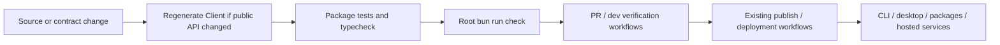
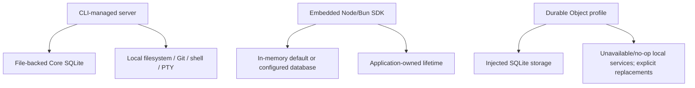

# 13 — Development, verification, and delivery

[Architecture index](../README.md) · Previous: [Security](12-security-boundaries.md) · Next: [Sources](sources.md)

## Build and verification structure

The root is a private Bun workspace with shared dependency catalogs. Turborepo coordinates package tasks and caches declared outputs. TypeScript, Oxlint, ast-grep rules, package tests, component tests, and Playwright cover different boundaries.

This is the contributor workflow, not a claim that all jobs form one literal CI dependency chain. Unit, component, packaging, and browser checks are orchestrated by their own workflows and affected-package rules.

### Useful entrypoints

| Goal | Command and location |
| --- | --- |
| Install workspace dependencies | `bun install` at repository root. The root package declares the intended Bun version. |
| CLI/TUI development | `bun dev [directory]` at root. |
| TUI against current live service | `bun run dev:live [directory]` at root or a development worktree. |
| Backend for local web development | `bun dev serve --port 4096` at root. |
| Local web UI | `bun dev -- --port 4444` in `packages/app`. |
| Desktop development | `bun run dev:desktop` at root. |
| Current website/docs | `bun run dev:www` at root. |
| Full lint and type verification | `bun run check` at root. |
| Focused typecheck | `bun typecheck` in the affected package; do not run `tsc` directly. |
| Focused tests | Package-owned test command from that package, not the root `test` script. |
| Client regeneration | `bun run generate` in `packages/client`. |

Repository policy uses `dev` as the default branch and `origin/dev` as the normal comparison base. Releases use existing workflows, **not Changesets**.

## Runtime portability

Arrows show storage/capability binding for alternative hosts.

The Workerd profile disables local watchers/native discovery paths, uses precompiled plugins, and does not pretend that bare Locations have a local shell, PTY, or filesystem. Snapshot/VCS can degrade to no-op/empty behavior; unavailable operations fail explicitly. A remote execution plane must be supplied deliberately.

## Hosted services are separate deployments

| Area | Purpose | Deployment/configuration anchor |
| --- | --- | --- |
| `services/www` | Website and current V2 docs | [`deploy-www.yml`](../../.github/workflows/deploy-www.yml) |
| `services/update` | Release metadata, artifact selection, desktop update feeds | [README](../../services/update/README.md), [`deploy-update.yml`](../../.github/workflows/deploy-update.yml) |
| `services/files` | Public file distribution | [README](../../services/files/README.md), [`deploy-files.yml`](../../.github/workflows/deploy-files.yml) |
| `services/changelog` | Published release notes | [README](../../services/changelog/README.md), [`deploy-changelog.yml`](../../.github/workflows/deploy-changelog.yml) |
| `packages/console` | Hosted Console product | [`infra/console.ts`](../../infra/console.ts) |
| `packages/stats` | Analytics/statistics system | [`infra/stats.ts`](../../infra/stats.ts) |
| `packages/enterprise` | Hosted enterprise concerns | [`infra/enterprise.ts`](../../infra/enterprise.ts) |

SST config selects stage-dependent infrastructure and providers; individual website/distribution services also have Wrangler deployment workflows. Do not infer that every local agent run requires the hosted Console or that every package is a deployable service.

The service overview currently links `updates`, while the checked-out directory is singular `services/update`; this guide uses the directory that exists.

## Verification by boundary

- Schema/Protocol changes: validate contract behavior and regenerate/check generated outputs.
- Core changes: test admission, projection, execution, and recovery at their owning package boundary.
- AI provider changes: cassette-based provider tests normally replay without API keys.
- UI changes: use the area's component/e2e owner; session/timeline changes require performance baseline comparison.
- Desktop changes: distinguish IPC/native storage from renderer behavior.
- Runtime-profile changes: verify packaging and capability replacement, not only Node typechecking.

## Source anchors

- [Root scripts/catalog](../../package.json), [Turbo task graph](../../turbo.json), [contributor workflow](../../CONTRIBUTING.md)
- [Check workflow](../../.github/workflows/check.yml), [tests](../../.github/workflows/test.yml), [publish](../../.github/workflows/publish.yml)
- [Infrastructure entrypoint](../../sst.config.ts), [infrastructure modules](../../infra)
- [Node server process](../../packages/server/src/process.ts), [Workerd profile](../../packages/server/src/workerd.ts)
- [SDK hosting](../../packages/sdk/README.md), [AI testing rules](../../packages/ai/AGENTS.md)
