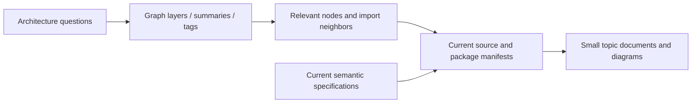

# Sources, graph research, and maintenance

[Architecture index](../README.md)

## Provenance

| Evidence | Snapshot |
| --- | --- |
| Root package | `opencode`, version `2.0.28`; private Bun workspace. |
| Verified source HEAD | `9a4ef65e519c5b3e7c68420c1c9d8047205f3ca1`. |
| Supplied graph | [`.ua/knowledge-graph.json`](../../.ua/knowledge-graph.json), format `1.0.0`. |
| Graph timestamp | `2026-10-17T17:01:32.434Z`; metadata records completion at `2026-10-17T17:06:32.0990147Z`. |
| Graph commit | `06c76cbc3687ac3413212e3c1a72a46eb2fce618`; different from verified source HEAD. |
| Graph size | 12,971 nodes and 20,862 edges; metadata reports 5,742 analyzed files. Nodes include symbols/documents/configuration, not just files. |

These documents describe the local checkout. They do not assert that the fork exactly matches upstream OpenCode or that its hosted infrastructure is currently deployed.

## How the graph was used

The `.ua` directory supplies a static JSON knowledge graph, layer descriptions, tags, node summaries, import edges, and an ordered tour. No vector index or semantic-search endpoint was exposed through the available tools. Research therefore used **concept-oriented searches over names, summaries, and tags**, plus dependency-edge traversal—not an embedding-based semantic search service.

### Research topics

| Concept cluster | Graph/source areas inspected | Chapters |
| --- | --- | --- |
| Package layers and clients | Graph layer definitions, tour, workspace manifests | 01, 02, 11 |
| Composition and placement | `instance`, `location-services`, `location-service-map`, Server routes, SDK host | 03, 07 |
| Session admission/execution/recovery | Inbox, execution, coordinator, runner, restart, Session operations | 04 |
| Durable facts, projections, storage | Bus, event SQL, Session SQL/projectors, database construction | 05, 06 |
| Provider routing and model calls | AI LLM schemas, route client, provider protocols, Core resolver | 08 |
| Tools, hooks, and permissions | Tool registry/MCP, Code Mode, plugin supervisor/host, policy | 09, 10, 12 |
| UI and delivery | TUI contexts, App server runtime, Electron boundaries, CI/infra | 11, 13 |

## Why current-source validation matters

Some graph summaries are generic and some tour descriptions are outdated. The graph is a discovery aid, not an architectural authority:

- Its README tour describes installation guidance, while the current root README is a short maintenance notice.
- Its Client tour references an older `contract.ts` structure; current generation compiles Protocol's `ClientApi`.
- The current source defaults historical event payload retention to false, despite “durable event” terminology elsewhere.
- The service overview has a plural update-service link, while the directory is `services/update`.
- Historical physical names such as `session_v2` and retained V1 subtrees do not rename current public domains or make V1 documentation current.

Import edges show code relationships, not proof of runtime call order, deployment, or security isolation. Diagram interactions were checked against service construction and semantic contracts, not inferred from graph centrality alone.

## Authority and further reading

1. [Schema](../../packages/schema/src): public domain shapes and event definitions.
2. [Protocol](../../packages/protocol/src): operation methods, paths, schemas, errors, and middleware placement.
3. [Core](../../packages/core/src): runtime behavior and persistence.
4. [Server](../../packages/server/src): concrete transport and composition.
5. [Current specifications](../../specs/v2/README.md): cross-module Session/tool semantics and accepted decisions.
6. [Root contributor guardrails](../../AGENTS.md): dependency, generation, testing, and release constraints.
7. [Current V2 docs source](../../services/www/src/docs/content) and [published V2 introduction](https://opencode.ai/v2/docs/): product-facing context, not proof that a local fork has identical code.

The historical catalog/config/plugin lifecycle document under `specs/v2` is historical context, not a current implementation checklist. Older website docs under `packages/web` are not used as the V2 authority.

## Keeping this guide useful

- Update only the chapter that owns the changed concern, then adjust cross-links if necessary.
- Keep each diagram to one viewpoint; split diagrams when dependencies, deployment, and data flow differ.
- Keep exact schema and endpoint details in their owning source rather than copying large signatures here.
- Recheck runtime defaults, selection paths, failure guarantees, and source links after architectural changes.
- Preserve the distinction between implementation, design constraints, and future work: clustered ownership/fencing and exactly-once external effects are **not** implemented guarantees.
- If the graph is refreshed, record its new commit/timestamp; do not silently treat old summaries as current.
